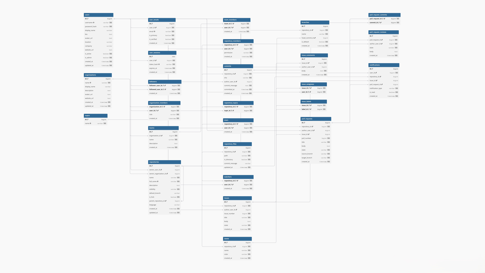

<div align="center">

# Open Source System (OSS)

**A GitHub-inspired web platform for hosting repositories, tracking issues, reviewing pull requests and collaborating in organizations — built on a 26-table, 3NF-normalized MySQL database.**


[Quick Start](#quick-start) · [Features](#features) · [ER Diagram](#er-diagram) · [Installation Guide](#installation-and-setup-guide) · [API](#api-overview) · [Roadmap](#roadmap)

</div>

---

## Table of Contents

- [About the Project](#about-the-project)
- [Problem Statement](#problem-statement)
- [Objectives](#objectives)
- [Features](#features)
- [Technology Stack](#technology-stack)
- [System Architecture](#system-architecture)
- [Project Structure](#project-structure)
- [Database Design](#database-design)
- [ER Diagram](#er-diagram)
- [Relational Schema](#relational-schema)
- [Relationships and Normalization](#relationships-and-normalization)
- [SQL Implementation](#sql-implementation)
- [Installation and Setup Guide](#installation-and-setup-guide)
- [Environment Configuration](#environment-configuration)
- [API Overview](#api-overview)
- [Security Considerations](#security-considerations)
- [Demo Walkthrough](#demo-walkthrough)
- [Roadmap](#roadmap)
- [Documentation](#documentation)
- [Contributing](#contributing)
- [License](#license)

---

## About the Project

Open Source System (OSS) is a web-based open-source collaboration platform inspired by GitHub. Users can manage repositories, open issues and pull requests, join organizations and teams, and interact through stars, watchers and follows.

It started as a **Database Management Systems (DBMS) course project** and is designed around a strong relational core: every feature is backed by explicit tables, primary/foreign keys and parameterized SQL.

**Repository:** https://github.com/arshc0der/open-source-system

## Problem Statement

Developers need one centralized place to host and manage projects. Collaboration involves many kinds of data — users, repositories, issues, organizations and social interactions — and these entities are tightly interrelated. Ad-hoc storage breaks consistency.

A well-designed relational database solves this:

| | Benefit | How OSS achieves it |
|---|---|---|
| 1 | **Integrity** | Primary and foreign keys keep every reference valid |
| 2 | **Relationships** | Join tables model M:N pairs such as stars and followers |
| 3 | **Query power** | Joins and aggregates answer real questions in SQL |
| 4 | **No redundancy** | Normalization to 3NF removes duplicated data |

## Objectives

1. Design a structured relational schema for collaboration data.
2. Manage users, repositories and organizations efficiently.
3. Establish explicit relationships between all entities.
4. Maintain data integrity and consistency through constraints.
5. Implement every data operation in SQL — inserts, selects, updates and deletes.

## Features

| Area | What you can do |
|---|---|
| **User profiles** | Register, log in, edit bio and profile, upload an avatar, keep multiple e-mail addresses |
| **Repositories** | Create public/private repos, browse and edit files, create branches, commit, fork |
| **Organizations** | Create organizations, add members with roles, create teams and manage team members |
| **Issues** | Open and close issues, comment, create labels, assign users |
| **Pull requests** | Open pull requests, review them, link commits, track open / merged / closed state |
| **Topics** | Classify repositories with topics |
| **Stars & watchers** | Give feedback signals on repositories |
| **Follows & notifications** | Follow users and receive activity alerts, mark them as read |

> This list reflects the routes, models and pages in the source tree. It does not imply that every workflow is production-ready; some parts are still under development.

## Technology Stack

| Layer | Technology | Purpose |
|---|---|---|
| Frontend | React 19 · HTML · CSS · JavaScript | Component-based UI |
| Frontend tooling | Vite | Dev server and production builds |
| Routing | React Router | Client-side navigation |
| Styling | Tailwind CSS 4 | UI styling |
| Icons | React Icons | Interface icons |
| Backend | Node.js · Express 5 | REST API and middleware |
| Database | MySQL (InnoDB, `utf8mb4`) | Relational persistence |
| DB driver | mysql2 | Promise-based, parameterized queries |
| Authentication | JSON Web Tokens | Access-token auth |
| Password security | Argon2 | Password hashing |
| Version control | Git · GitHub | Source management |
| Data modeling | dbdiagram.io | ER diagram design |

## System Architecture

Three tiers: **React client → Express API → MySQL core**.

```text
+------------------------------+
|          Web Browser         |
|       React + Vite UI        |
+---------------+--------------+
                |
                | HTTP / JSON  (/api/*)
                v
+------------------------------+
|       Node.js / Express      |
|                              |
| Routes -> Middleware         |
|        -> Controllers        |
|        -> Services / Models  |
+---------------+--------------+
                |
                | mysql2 (parameterized SQL)
                v
+------------------------------+
|           MySQL              |
|      open_source_system      |
|   26 tables · PK / FK · 3NF  |
+------------------------------+

File storage on the backend:
  backend/storage/repositories/   → repository content
  backend/uploads/avatars/        → profile pictures
```

**Request flow**

1. A user performs an action in the React app.
2. The frontend sends an HTTP request to the relevant `/api` endpoint.
3. Express routes it to the right controller.
4. Authentication middleware validates protected requests.
5. Model classes run **parameterized SQL** — no string-built queries.
6. The API returns a JSON response.

## Project Structure

```text
open-source-system/
├── backend/
│   ├── config/            # db.js, env.js
│   ├── controllers/       # request handling
│   ├── middleware/        # auth, error handler
│   ├── models/            # one model class per domain (SQL lives here)
│   ├── routes/            # REST endpoint definitions
│   ├── service/           # auth, hashing, tokens
│   ├── sql/
│   │   └── schema.sql     # source of truth for the database
│   ├── storage/           # repository content (runtime)
│   ├── uploads/           # avatars (runtime)
│   ├── index.js           # Express entry point
│   └── package.json
│
├── client/
│   ├── src/
│   │   ├── Component/     # reusable UI components
│   │   ├── Pages/         # Dashboard, Login, Profile, RepoDetail, ...
│   │   ├── api.js         # API client
│   │   ├── App.jsx
│   │   └── main.jsx
│   ├── index.html
│   ├── vite.config.js
│   └── package.json
│
├── docs/
│   ├── diagrams/
│   │   └── er-diagram.jpg
│   └── OpenSourceSystem-DBMS-Presentation.pdf
│
└── README.md
```

## Database Design

The database is **MySQL**, named `open_source_system`. The canonical schema is:

```text
backend/sql/schema.sql
```

It defines **26 tables** in four groups around the repository core:

| Group | Tables | Count |
|---|---|:---:|
| **Identity & access** | `users` · `user_emails` · `user_sessions` | 3 |
| **Repository core** | `repositories` · `branches` · `commits` · `repository_files` · `topics` · `repository_topics` | 6 |
| **Collaboration** | `issues` · `issue_comments` · `labels` · `issue_labels` · `issue_assignees` · `pull_requests` · `pull_request_commits` · `pull_request_reviews` | 8 |
| **Organization & social** | `organizations` · `organization_members` · `teams` · `team_members` · `repository_members` · `followers` · `stars` · `watchers` · `notifications` | 9 |

**Design notes**

- InnoDB tables with foreign-key constraints; `utf8mb4` encoding.
- Unique constraints prevent duplicate usernames, repository names and similar records.
- Indexes cover the commonly queried relationships.
- Passwords are stored as Argon2 hashes, never as plaintext.
- Session token hashes are stored separately from short-lived access tokens.
- Every collaboration record traces back to a repository and a user; join tables carry nothing beyond keys and timestamps.

If the schema changes, update this section and the ER diagram together.

## ER Diagram

Crow's-foot notation · key icon marks PK / FK · all 26 tables shown.



> Click the image on GitHub and zoom in for full detail. Source: exported from [dbdiagram.io](https://dbdiagram.io).

**How to read it**

- **Ownership is split** — a repository is owned by a user (`owner_user_id`) *or* an organization (`owner_organization_id`).
- **Join tables resolve M:N** — `stars`, `watchers`, `followers`, `repository_topics`, `issue_labels`, `issue_assignees`, `team_members`, `pull_request_commits`.
- **Children carry the parent key** — issues, comments, reviews and notifications all reference the repository or issue they belong to, so deletes and updates stay consistent.

**High-level relationships**

```text
USER ──creates 1:N──▶ REPOSITORY ◀──owns 1:N── ORGANIZATION
USER ◀──stars M:N──▶ REPOSITORY
REPOSITORY ──has 1:N──▶ ISSUE
REPOSITORY ──has 1:N──▶ PULL REQUEST
USER ◀──follows M:N──▶ USER
REPOSITORY ◀──M:N──▶ TOPIC
```

## Relational Schema

Selected core tables (full column lists are in the ER diagram and `schema.sql`).

<details>
<summary><b>users</b></summary>

| Column | Type | Key / constraint |
|---|---|---|
| id | bigint | PK |
| username | varchar | NN · UNIQUE |
| password_hash | varchar | NN |
| display_name | varchar | — |
| bio | text | — |
| avatar_url | text | — |

</details>

<details>
<summary><b>repositories</b></summary>

| Column | Type | Key / constraint |
|---|---|---|
| id | bigint | PK |
| owner_user_id | bigint | FK → users.id |
| owner_organization_id | bigint | FK → organizations.id |
| name | varchar | NN |
| visibility | varchar | NN · public / private |
| default_branch | varchar | — |

</details>

<details>
<summary><b>issues</b></summary>

| Column | Type | Key / constraint |
|---|---|---|
| id | bigint | PK |
| repository_id | bigint | FK → repositories.id · NN |
| author_user_id | bigint | FK → users.id |
| issue_number | bigint | NN · per-repository sequence |
| title | varchar | NN |
| state | varchar | NN · open / closed |

</details>

<details>
<summary><b>pull_requests</b></summary>

| Column | Type | Key / constraint |
|---|---|---|
| id | bigint | PK |
| repository_id | bigint | FK → repositories.id · NN |
| author_user_id | bigint | FK → users.id |
| issue_id | bigint | FK → issues.id · links PR to its issue |
| pull_number | bigint | NN · per-repository sequence |
| state | varchar | NN · open / merged / closed |
| source_branch | varchar | NN |
| target_branch | varchar | NN |

</details>

`PK` primary key · `FK` foreign key · `NN` NOT NULL. The remaining tables (labels, comments, stars, watchers, …) follow the same pattern.

## Relationships and Normalization

### Cardinality as enforced by foreign keys

| Relationship | Implemented as | Cardinality |
|---|---|:---:|
| User → Repository | `repositories.owner_user_id` | 1 : N |
| Organization → Repository | `repositories.owner_organization_id` | 1 : N |
| Repository → Issue | `issues.repository_id` | 1 : N |
| Repository → Pull request | `pull_requests.repository_id` | 1 : N |
| Issue → Comment | `issue_comments.issue_id` | 1 : N |
| User ↔ User (follows) | `followers` join table | M : N |
| User ↔ Repository (stars) | `stars` join table | M : N |
| Repository ↔ Topic | `repository_topics` join table | M : N |
| User ↔ Organization | `organization_members` (with `role`) | M : N |

### Normalization (3NF)

- **1NF — atomic values:** one value per column; multiple e-mail addresses live in `user_emails`, not in `users`.
- **2NF — no partial dependency:** join tables depend on the whole composite key, e.g. `stars(repository_id, user_id)`.
- **3NF — no transitive dependency:** labels and topics are stored once and referenced by id; nothing derivable is duplicated.

**Result:** no redundancy, and inserts, updates and deletes stay anomaly-free.

## SQL Implementation

The model layer contains **60+ parameterized queries** (Follow, Issue, Notification, Organization, PullRequest, Repository models). One example per operation type:

**Insert — open an issue** (issue number comes from a per-repository sequence)

```sql
-- next issue number
SELECT COALESCE(MAX(issue_number), 0) + 1 FROM issues WHERE repository_id = ?;

INSERT INTO issues (repository_id, author_user_id, issue_number, title, body, state, created_at)
VALUES (?, ?, ?, ?, ?, 'open', ?);
```

**Retrieve — issue list** (LEFT JOIN plus a correlated subquery for comment counts)

```sql
SELECT i.*, u.username AS author_username,
       (SELECT COUNT(*) FROM issue_comments c WHERE c.issue_id = i.id) AS comment_count
FROM issues i
LEFT JOIN users u ON u.id = i.author_user_id
WHERE i.repository_id = ?
ORDER BY i.issue_number DESC;
```

**Update — state changes** (on merge, the pull request advances the branch head)

```sql
UPDATE issues SET state = ? WHERE id = ?;
UPDATE branches SET head_commit_id = ? WHERE repository_id = ? AND name = ?;
```

**Authorize — write check** (owner, repository member, or organization admin)

```sql
SELECT EXISTS (
  SELECT 1 FROM repositories r
  WHERE r.id = ? AND (
    r.owner_user_id = ?
    OR EXISTS (SELECT 1 FROM repository_members rm
               WHERE rm.repository_id = r.id AND rm.user_id = ?
                 AND rm.permission IN ('write','admin'))
    OR EXISTS (SELECT 1 FROM organization_members om
               WHERE om.organization_id = r.owner_organization_id AND om.user_id = ?
                 AND om.role IN ('owner','admin'))
  )
) AS can_write;
```

---

## Quick Start

Already have Node.js 18+ and MySQL 8 running? Here is the short version:

```bash
git clone https://github.com/arshc0der/open-source-system.git
cd open-source-system

# 1. database
mysql -u root -p < backend/sql/schema.sql

# 2. backend  (terminal 1)
cd backend && npm install && npm run dev

# 3. frontend (terminal 2)
cd client && npm install && npm run dev
```

Open **http://localhost:5173**. For the full, step-by-step guide, read on.

---

## Installation and Setup Guide

Follow these steps to download, configure, and run Open Source System locally.

### Prerequisites

- **Node.js** (current LTS recommended) and **npm**
- **MySQL Server 8.0** (or compatible) and **MySQL Workbench** (optional but recommended)
- **Git**
- A terminal or command prompt

### Step 1: Clone the Repository

Open your terminal and execute:

```bash
git clone https://github.com/arshc0der/open-source-system.git
cd open-source-system
```

### Step 2: Set Up the MySQL Database

Make sure MySQL Server is installed and running.

1. Open MySQL Workbench.
2. Connect to your local MySQL server.
3. Open a new SQL tab.
4. Execute the following command:

   ```sql
   CREATE DATABASE open_source_system;
   ```

5. Open the project's database schema: [backend/sql/schema.sql](https://github.com/arshc0der/open-source-system/blob/main/backend/sql/schema.sql)
6. Open the `schema.sql` file in a text editor.
7. Copy the complete SQL script.
8. Return to MySQL Workbench.
9. Select the `open_source_system` database using:

   ```sql
   USE open_source_system;
   ```

10. Paste the complete schema script into the SQL editor.
11. Click the **Execute** button (lightning icon) to run the script.

The SQL script creates **26 relational tables**, including users, repositories, organizations, teams, commits, branches, issues, pull requests, notifications, and other supporting tables.

Once execution completes successfully, refresh the **Schemas** panel in MySQL Workbench and expand `open_source_system` to verify the tables.

> **Important:** Execute the complete schema script before starting the backend.

> **Command-line alternative:** from the project root, run `mysql -u root -p < backend/sql/schema.sql`. The script also creates the database if it does not already exist.

### Step 3: Configure the Database Connection

Open [backend/config/db.js](https://github.com/arshc0der/open-source-system/blob/main/backend/config/db.js) and verify the MySQL connection configuration.

```js
import mysql from "mysql2/promise";

const db = mysql.createPool({
  host: process.env.DB_HOST || "localhost",
  user: process.env.DB_USER || "root",
  password: process.env.DB_PASSWORD ?? "",
  database: process.env.DB_NAME || "open_source_system",
  waitForConnections: true,
  connectionLimit: 10,
  queueLimit: 0,
  dateStrings: true,
});

export const testConnection = async () => {
  try {
    const connection = await db.getConnection();
    console.log("MySQL connected successfully");
    connection.release();
    return true;
  } catch (error) {
    console.error("MySQL connection failed:", error.message);
    return false;
  }
};

export default db;
```

Update the following values according to your local MySQL configuration:

- `host`: your MySQL server hostname.
- `user`: your MySQL username, commonly `root` for local development.
- `password`: your MySQL password.
- `database`: keep it as `open_source_system`.

If you use the default local configuration, you may not need to change anything. You can also set these through environment variables — see [Environment Configuration](#environment-configuration).

### Step 4: Install Backend Dependencies

Open a terminal in the project root and execute:

```bash
cd backend
npm install
```

### Step 5: Install Frontend Dependencies

Open another terminal in the project root and execute:

```bash
cd client
npm install
```

### Step 6: Start the Backend Server

First, make sure your MySQL server is running. Then:

```bash
cd backend
npm run dev
```

The backend server starts on:

```text
http://localhost:4000
```

To verify the backend, open:

```text
http://localhost:4000/api/health
```

You should receive a successful health-check response (`{ "ok": true }`).

### Step 7: Start the Frontend Application

Keep the backend terminal running. Open another terminal:

```bash
cd client
npm run dev
```

Vite starts the frontend development server. Open the local URL shown in your terminal. By default:

```text
http://localhost:5173
```

The frontend communicates with the backend API through the configured Vite proxy (`/api` and `/uploads` → `http://localhost:4000`).

### Step 8: Automatic Storage and Upload Directories

Open Source System automatically creates directories for repository storage and profile picture uploads when the relevant operations are performed. These directories are maintained on the backend side.

**Repository storage**

```text
backend/
└── storage/
    └── repositories/
        ├── repository-1/
        ├── repository-2/
        └── repository-3/
```

The application uses this location to maintain repository content, including files and repository-related data. When a user creates a repository or uploads repository content, the required directories are created automatically.

**Profile picture storage**

```text
backend/
└── uploads/
    └── avatars/
        ├── avatar-1.png
        ├── avatar-2.jpg
        └── avatar-3.png
```

When a user uploads or changes their profile picture, the backend creates the required avatar directory if it does not already exist and stores the uploaded image there. Uploaded images are served through the `/uploads` route.

> **Important:** These directories are generated at runtime. You do not need to create them manually.
>
> Keep the `storage/` and `uploads/` directories in persistent storage when deploying, and back them up regularly because they contain user-generated content.

### Step 9: Access the Application

Once both servers are running, open:

```text
http://localhost:5173
```

You can now register an account, sign in, create repositories, manage projects, and explore the collaboration features.

### Running Both Servers

Keep two terminal windows open during local development. Start the backend first, then the frontend.

| Terminal | Directory | Command |
|---|---|---|
| Terminal 1 | `backend` | `npm run dev` |
| Terminal 2 | `client` | `npm run dev` |

Other useful commands:

| Command | Where | What it does |
|---|---|---|
| `npm start` | `backend` | Run the API without watch mode |
| `npm run build` | `client` | Production build of the frontend |
| `npm run preview` | `client` | Preview the production build locally |
| `npm run lint` | `client` | Run ESLint |

### Troubleshooting

**MySQL connection failed**

- Verify that MySQL Server is running.
- Check your database username and password.
- Confirm that `open_source_system` exists.
- Ensure that the schema script was executed successfully.

**Frontend cannot connect to backend**

- Confirm that the backend is running on port `4000`.
- Confirm that the frontend is running on port `5173`.
- Check the backend terminal for errors.

**Missing dependencies**

Run the following inside the relevant directory:

```bash
npm install
```

**Repository or avatar files are not appearing**

- Check that the backend is running from the `backend` directory.
- Verify write permissions for the backend directory.
- Check the relevant `storage/` or `uploads/` paths.

> **Note:** Repository storage and avatar uploads are stored locally by default. To use your own cloud storage provider, modify the respective backend storage and upload implementations to integrate your preferred cloud service.

## Environment Configuration

The backend reads operating-system environment variables. No `.env` loader is configured, so a `.env` file alone is **not** loaded automatically.

| Variable | Description | Default |
|---|---|---|
| `PORT` | Backend HTTP port | `4000` |
| `CLIENT_ORIGIN` | Allowed frontend origin for CORS | `http://localhost:5173` |
| `DB_HOST` | MySQL host | `localhost` |
| `DB_USER` | MySQL username | `root` |
| `DB_PASSWORD` | MySQL password | *(empty)* |
| `DB_NAME` | MySQL database name | `open_source_system` |
| `ACCESS_TOKEN_SECRET` | Secret for signing access tokens | development fallback — **replace it** |
| `REFRESH_TOKEN_SECRET` | Secret for signing refresh/session tokens | development fallback — **replace it** |

> Always set strong, unique token secrets in production. Never commit credentials or private keys.

<details>
<summary>PowerShell example</summary>

```powershell
$env:DB_HOST = "localhost"
$env:DB_USER = "root"
$env:DB_PASSWORD = "your_mysql_password"
$env:DB_NAME = "open_source_system"
$env:ACCESS_TOKEN_SECRET = "replace_with_a_long_random_secret"
$env:REFRESH_TOKEN_SECRET = "replace_with_another_long_random_secret"
$env:CLIENT_ORIGIN = "http://localhost:5173"
$env:PORT = "4000"
```

</details>

<details>
<summary>macOS / Linux example</summary>

```bash
export DB_HOST=localhost
export DB_USER=root
export DB_PASSWORD=your_mysql_password
export DB_NAME=open_source_system
export ACCESS_TOKEN_SECRET=replace_with_a_long_random_secret
export REFRESH_TOKEN_SECRET=replace_with_another_long_random_secret
export CLIENT_ORIGIN=http://localhost:5173
export PORT=4000
```

</details>

## API Overview

All endpoints live under the `/api` prefix.

| Base path | Purpose |
|---|---|
| `/api/health` | API health check |
| `/api/auth` | Registration, login, logout |
| `/api/me` | Current user's profile, avatar and account |
| `/api/users` | User listing, lookup, follow |
| `/api/profile` | Public profile lookup |
| `/api/repos` | Repositories, files, commits, branches, stars, watches, forks |
| `/api/repos/:id/issues` | Issues, comments, labels, collaborators |
| `/api/repos/:id/pulls` | Pull requests and reviews |
| `/api/organizations` | Organizations, members and teams |
| `/api/notifications` | Notification listing and read status |

```bash
curl http://localhost:4000/api/health
# {"ok":true}
```

Protected endpoints require a valid token. See `backend/routes/` for exact methods and parameters.

## Security Considerations

**Already in the codebase**

- Argon2 password hashing.
- JWT-based authentication with short-lived (15 min) access tokens.
- Hashed session tokens stored in `user_sessions`.
- Authentication middleware on protected routes.
- Parameterized SQL queries throughout the model layer.
- Foreign-key constraints and database-level integrity rules.

**Before deploying publicly**

- Replace all development fallback secrets with strong, environment-specific secrets.
- Serve everything over HTTPS.
- Use a dedicated least-privilege MySQL account and restrict network access.
- Validate and sanitize all user input; validate upload type, size and content.
- Review authorization for repository ownership, organization membership and collaborators.
- Set production CORS origins explicitly.
- Add rate limiting and monitoring on authentication endpoints.
- Back up the database and the `storage/` and `uploads/` directories regularly.
- Keep dependencies updated and review security advisories.

## Demo Walkthrough

1. Register and log in
2. Open your user profile
3. Create a repository
4. Upload files and commit
5. Open an issue with labels
6. Create an organization and invite members

## Roadmap

Planned, **not yet built**:

- [ ] **Git integration** — real Git protocol backend
- [ ] **Access control** — finer-grained repository permissions
- [ ] **Code review** — inline comments on pull-request diffs
- [ ] **CI / CD** — automated checks on merge
- [ ] **Notifications** — e-mail and in-app digests
- [ ] **Cloud deployment** — managed MySQL hosting
- [ ] **Full-text search** — across code and issues
- [ ] Automated backend and frontend tests
- [ ] Full API reference with request/response examples

## Documentation

| Resource | Location |
|---|---|
| ER diagram | [`docs/diagrams/er-diagram.jpg`](docs/diagrams/er-diagram.jpg) |
| Database schema | [`backend/sql/schema.sql`](backend/sql/schema.sql) |

## Contributing

Contributions, suggestions and bug reports are welcome.

1. Fork the repository.
2. Create a feature branch:

   ```bash
   git checkout -b feature/your-feature-name
   ```

3. Make your changes and add or update tests where appropriate.
4. Run the relevant lint and build checks.
5. Commit with a clear message:

   ```bash
   git commit -m "Add: describe your change"
   ```

6. Push your branch and open a Pull Request.

For substantial changes, please open an issue first to discuss the proposal.

**Guidelines**

- Keep `backend/sql/schema.sql` in sync with model changes, and update the ER diagram when relationships change.
- Keep frontend API calls aligned with backend routes.
- Don't commit `node_modules`, build output, secrets or private user data.
- Treat repository files and uploads as untrusted input.

## License

No license has been specified yet. To make this project truly open source, add a `LICENSE` file (for example MIT or Apache-2.0) to the repository root and update this section.

## Project Links

- **Repository:** https://github.com/arshc0der/open-source-system
- **Issues:** https://github.com/arshc0der/open-source-system/issues
- **Pull requests:** https://github.com/arshc0der/open-source-system/pulls

---

<div align="center">

Open Source System

</div>
